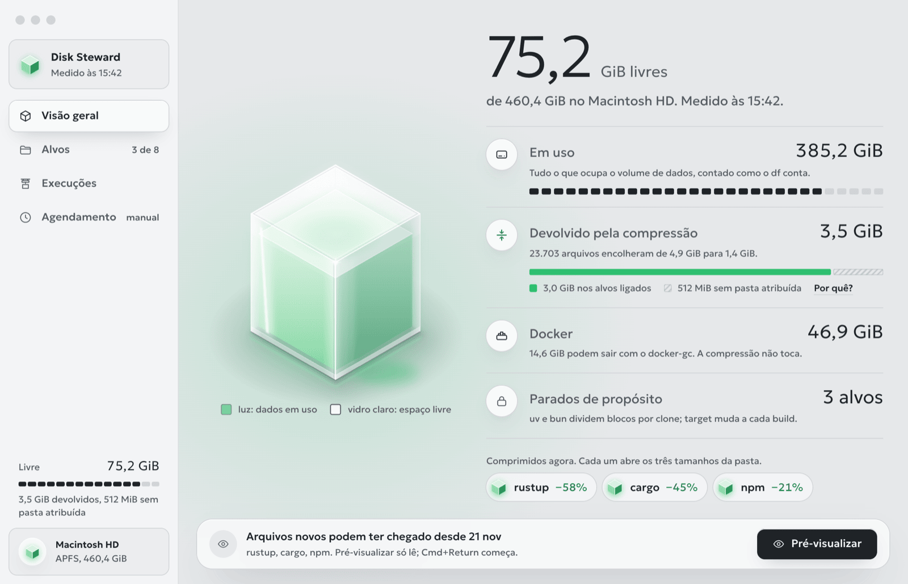
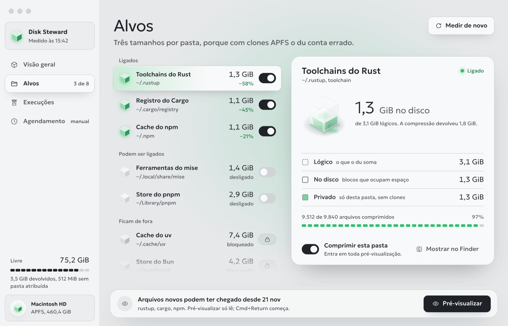
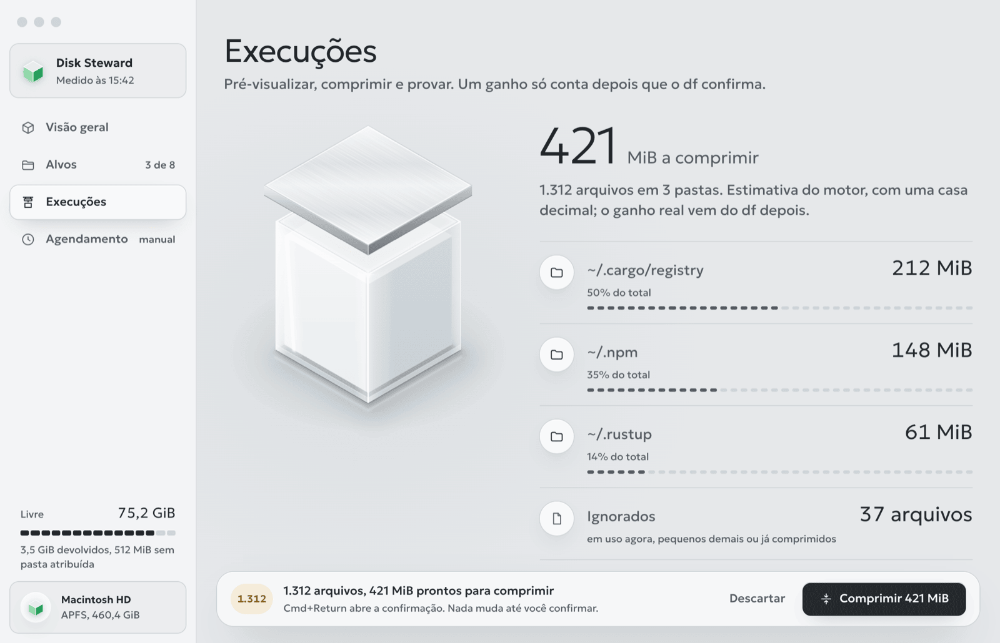
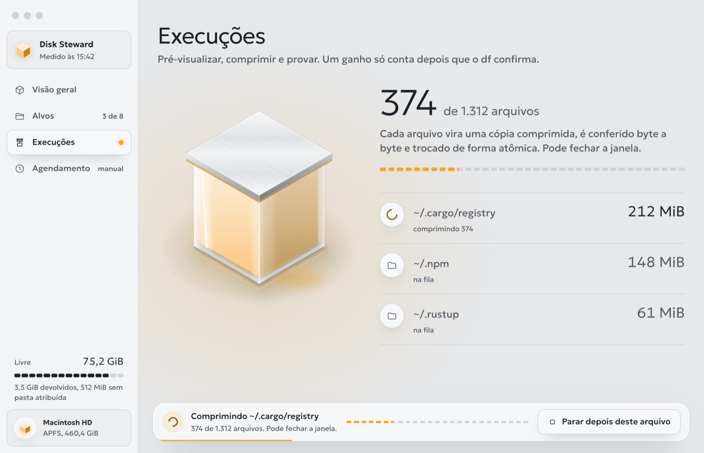
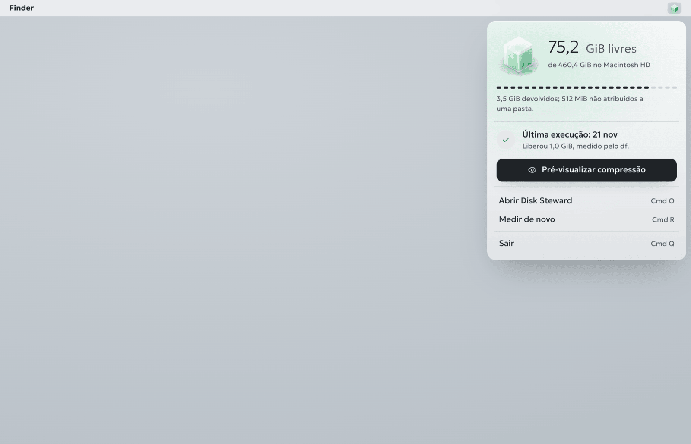
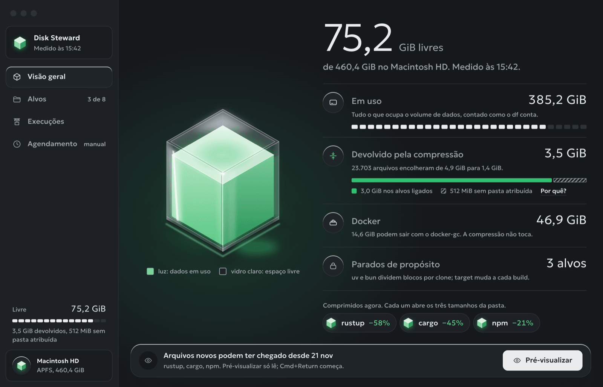

<p align="center">
  
</p>

<h1 align="center">Disk Steward</h1>

<p align="center">A macOS menu-bar app and CLI that controls APFS transparent compression for developer caches, and refuses the cases where it would backfire.</p>

<p align="center">
  <a href="https://github.com/lucasbrito-wdt/disk-steward/actions/workflows/ci.yml"></a>
  <a href="LICENSE"></a>
  
  
</p>

<p align="center">
  
</p>

## Why

Developer machines fill up with caches that are easy to rebuild but expensive to keep: Rust toolchains, the cargo
registry, the npm cache, the uv cache. APFS can compress files transparently, so tools keep reading them as usual while
they take less space. The catch is that `du` lies on APFS: clones share blocks, so a folder can look big while owning
little, or look compressible while compressing it would store shared blocks twice and make things worse.

Disk Steward measures each folder the honest way, compresses only what is safe, and shows the result as bytes actually
freed, measured with `df`.

On the author's Mac it freed about 6.5 GiB from `~/.rustup`, `~/.cargo/registry`, `~/.npm` and the uv cache. The uv
cache alone went from 9.3 GB to 5.6 GB on disk.

## How it works

Disk Steward is a front end for [`auto-compress-apfs`](https://crates.io/crates/auto-compress-apfs), the engine that does
the compression. The engine compresses files with `ditto`/`applesauce`, verifies the result byte by byte and swaps it in
atomically. Disk Steward decides what the engine is allowed to touch, shows what it would do, and tracks the result.

### Three sizes per folder

| Size | What it is |
| --- | --- |
| **Logical** | The sum of file sizes. |
| **On disk** | Blocks actually allocated. This is what `du` reports, and it counts clones in full. |
| **Private** | Bytes not shared with any APFS clone (`ATTR_CMNEXT_PRIVATESIZE`). |

The gap between on disk and private is what clones share with files elsewhere.

### Clone safety

If a folder's blocks are shared with clones, compressing it un-shares them and stores the data twice. Disk Steward
refuses to enable a target when more than `max(64 MiB, 10%)` of its on-disk bytes are shared. A few targets are decided by
rule instead of by measurement:

- The **bun store** is blocked because bun installs with `clonefile`.
- **Rust `target` directories** are blocked because every build rewrites them.
- The **uv cache** excludes the ephemeral `uvx` environments under `archive-v0`, which are clones of each other.

## Features

- Three sizes per folder, measured clone-aware.
- Built-in catalog: `~/.rustup`, `~/.cargo/registry`, `~/.npm`, `~/.cache/uv`, mise (`~/.local/share/mise`) and the pnpm
  store, plus custom paths.
- Preview before apply: see which files and how many bytes the engine would compress, with nothing changed.
- Live progress and cancel while a run is in progress. Cancelling is safe because the engine's swaps are atomic.
- Daily schedule through a LaunchAgent.
- Run history (the last 50 runs).
- Docker usage view (images, build cache, volumes, reclaimable). Docker data is shown for reference and is never
  compressed; cleanup is left to `docker-gc`.
- Menu-bar icon with a compact window.
- Interface in Portuguese (Brazil) and English, light and dark theme.
- Closing the window keeps the app running in the menu bar.

## Screenshots

| Targets | Preview |
| --- | --- |
|  |  |
| **Running** | **Menu bar** |
|  |  |

<p align="center">
  
</p>

## Install

### Download

1. Install the engine: `cargo install auto-compress-apfs` (the app looks for it at `~/.cargo/bin/auto-compress-apfs`).
2. Download the `.dmg` for your Mac (Apple Silicon or Intel) from the
   [latest release](https://github.com/lucasbrito-wdt/disk-steward/releases/latest) and drag the app to Applications.
3. The app is not notarized. On first launch macOS blocks it: open **System Settings > Privacy & Security** and click
   **Open Anyway**.

### Build from source

Requirements: macOS, Rust (stable), [Bun](https://bun.sh), the Tauri CLI and the engine.

```sh
cargo install tauri-cli --version "^2" --locked
cargo install auto-compress-apfs
git clone https://github.com/lucasbrito-wdt/disk-steward.git
cd disk-steward
scripts/install.sh
```

`scripts/install.sh` builds the app bundle and copies it to `/Applications` (or `~/Applications` if that is not
writable), with an ad-hoc signature. The app looks for the engine at `~/.cargo/bin/auto-compress-apfs`.

To remove it:

```sh
scripts/uninstall.sh                  # removes the app, keeps the schedule
scripts/uninstall.sh --with-schedule  # also removes the LaunchAgent
```

The engine config, logs and state in `~/.config/auto-compress-apfs` and `~/Library/Logs` are never touched.

## CLI

The `steward` binary lives in `crates/steward-core` and shares all its logic with the app. Run it from a checkout:

```sh
cargo run -p steward-core --bin steward -- <command>
```

| Command | What it does |
| --- | --- |
| `overview` | Disk, savings, targets, schedule and Docker in one view. |
| `targets` | Known targets with sizes and risk. |
| `measure <path>` | Clone-aware size of any directory. |
| `preview` | What the engine would compress now. Changes nothing. |
| `enable <id\|path>` | Add a target to the engine patterns. Refused for blocked or clone-shared targets. |
| `disable <id\|path>` | Remove a target from the engine patterns. |
| `apply --yes` | Compress the enabled targets for real. |
| `schedule` | LaunchAgents of interest and their last exit status. |

Options: `--json`, `--no-measure` (skip the file walk for `overview` and `targets`), `--yes`,
`--config <path>` (default `~/.config/auto-compress-apfs/default.toml`) and `--engine <path>` (default
`~/.cargo/bin/auto-compress-apfs`).

```sh
steward targets                  # sizes and risk for every known target
steward measure ~/.cache/uv      # logical, on disk and private bytes
steward enable npm
steward preview                  # read-only: what would be compressed
steward apply --yes
```

Measuring is bound by the kernel (roughly 10 microseconds per file) and the uv and bun folders hold hundreds of
thousands of files, so a full `overview` can take tens of seconds. Use `--no-measure` for an instant answer.

The JSON shapes and the Tauri commands are documented in [docs/API.md](docs/API.md).

## Schedule

The daily schedule is the engine's own LaunchAgent (`local.auto-compress-apfs`). Install or remove it from the app's
Schedule screen, or directly:

```sh
auto-compress-apfs install-launchd
auto-compress-apfs uninstall-launchd
```

`steward schedule` reports that agent and a `docker-gc` agent (`com.lucasbrito.docker-gc`, a job from the author's own
setup that this repo does not install), each shown as loaded or not, with the last exit status and log path. The engine's default log is `~/Library/Logs/auto-compress-apfs/launchd.log`.

## Safety guarantees

- `apply` never runs without confirmation: the CLI needs `--yes` and the app asks first.
- Preview is read-only and always available before apply.
- Targets that are blocked by rule, rewritten often, or clone-shared cannot be enabled, and `apply` refuses while one is
  enabled.
- The engine verifies every compressed file byte by byte and swaps it in atomically.
- Cancelling a run sends SIGINT to the engine, and its swaps are atomic.
- Editing the engine config only touches the top-level `patterns` array. Comments and the other sections stay
  byte-identical.
- Docker data is read-only here. Nothing in Docker is compressed or deleted.

## FAQ

**Why is bun (or pnpm) blocked?**
Bun installs packages with `clonefile`, so `node_modules` shares blocks with the global store. Compressing the store
un-shares those clones and the same data is stored twice, so you lose space. That rule is hard-coded for the bun store.
pnpm's global virtual store uses symlinks and the engine skips hardlinked files, so it is allowed; the measured shared
bytes still decide, because they are the ground truth for every target.

**Why are Rust `target` directories refused?**
They are rewritten on every build, so compressed files would be undone almost immediately, and some are deduplicated
with clones.

**Does it slow reads?**
Compression is transparent: tools read files as before and macOS decompresses on the fly. That costs some CPU on read.
Disk Steward has no benchmark of this overhead, so measure it on a workload you care about before enabling a hot path.
It targets caches and toolchains that are mostly read, not rewritten.

**Why do the numbers differ from the Finder?**
Disk Steward shows binary units (GiB, MiB), like `df -h` and the engine. The Finder uses decimal GB.

**Why does "saved" not match the sum of my folders?**
The engine counts only the files it compressed, and its state keeps rows for files deleted since. The app shows the
engine total and the difference as "not attributed to a folder". The reasoning is in [docs/API.md](docs/API.md).

**Is it macOS only?**
Yes. It relies on APFS.

## Roadmap

- Prebuilt, release-signed downloads (a release workflow is in progress).
- More targets in the catalog. See [CONTRIBUTING.md](CONTRIBUTING.md#adding-a-target-to-the-catalog); a
  [target request](https://github.com/lucasbrito-wdt/disk-steward/issues/new?template=target_request.yml) is a good first
  contribution.

## Project layout

| Path | Contents |
| --- | --- |
| `crates/steward-core` | Catalog, measurement, risk rules, engine wrapper, schedule, Docker usage and the `steward` CLI. No UI. |
| `src-tauri` | Tauri 2 shell: commands, events, tray and run history. |
| `ui` | Vue 3 + Vite interface (pt-BR and English). |
| `docs` | [API.md](docs/API.md) and the README images. |
| `design` | Design plan and tokens. |
| `scripts` | `install.sh` and `uninstall.sh`. |

## Contributing

Bug reports, target requests and pull requests are welcome. Read [CONTRIBUTING.md](CONTRIBUTING.md) first. Report
vulnerabilities as described in [SECURITY.md](SECURITY.md). This project follows the
[Code of Conduct](CODE_OF_CONDUCT.md).

## License

Released under the [GNU General Public License v3.0 only](LICENSE). You may use, study, modify and share it. If you
distribute a modified version, it must stay open under the same license, with its source available.

Disk Steward rewrites files on your disk through the engine. Run `steward preview` first and use it at your own risk.
